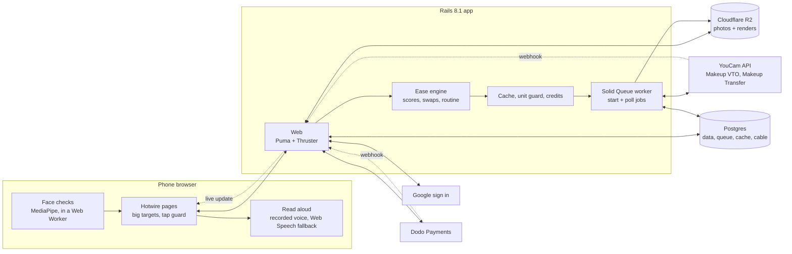
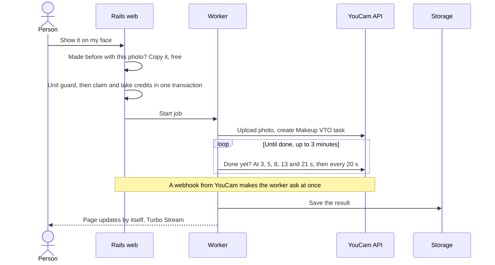

# Blendolo

**Makeup made easy for hands that shake.**

Makeup try-on for people with Parkinson's, essential tremor, arthritis, MS or after a stroke. Blendolo scores every look for *your* hands, swaps the hard steps for easier ones, and shows the classic and the easy version on your own face with the YouCam API.

**[Live site](https://blendolo.dijmo.com)** · **[Try an example person](https://blendolo.dijmo.com/examples)** (no photo, no sign in) · **Demo video (link coming)** · **[For shops](https://blendolo.dijmo.com/brands)**

[](https://codespaces.new/inventionsbyhamid/blendolo)


## Why

- More than 1 in 4 of 2,864 people with essential tremor say tremor affects putting on makeup ([Gupta et al. 2021](https://pmc.ncbi.nlm.nih.gov/articles/PMC8710410)).
- 5.33 million women live with Parkinson's, 45% of everyone with it ([GBD 2021, via Frontiers in Aging Neuroscience 2025](https://www.frontiersin.org/journals/aging-neuroscience/articles/10.3389/fnagi.2024.1498756/full)).
- 194 million people have osteoarthritis in their hands, women about twice as often as men ([Wei et al. 2025](https://www.ncbi.nlm.nih.gov/pmc/articles/PMC12350485/)).
- Virtual try-on shows a look on your face. It never asks whether your hands can do it. Blendolo does.

## What it does

- **5 questions about your hands** set your hand profile and how big the buttons get.
- **Hands-free photo**: prop the phone up. It waits for one face, looking straight, eyes open, then a still second, and talks you through it.
- **8 looks, scored for your hands**: Easy, Some care, Tricky or Hard, by the look's hardest step, shown as "Hard → Some care".
- **Classic vs easy, on your face**: hard steps become easier ones, rendered side by side. Winged liquid liner → shadow liner or a smudged pencil. Liquid matte lipstick → tinted balm dabbed on with a finger.
- **Signature look**: an old photo of a look you loved, put on today's face, then rebuilt from easy steps.
- **Step cards** read aloud in one recorded voice (the phone's own voice as a fallback), a **shopping list** tagged by grip and closure, and a **share link** for a helper or an occupational therapist (expires after 30 days, can be switched off).
- **Ease tags API for shops**: `GET /api/ease_tags?product_format=stick&closure=pull_cap&grip=chunky&step=tinted_balm`. Free, no key, 60 requests a minute.
- **Accounts and plans**: Google sign in, 2 free credits (one look on your face), a Look Pack ($7.99, 16 credits) and a Clinic plan for occupational therapists ($19 a month, 40 credits), through Dodo Payments.
- **3 example people** (Rosa, June, Amara) with stored results: explore for free, with no photo and no account.

The app follows its own advice: targets 64 to 104 px by "My hands today", main buttons at least 88 px, a tap counts on release and repeat taps are ignored, no drag, swipe, pinch or long press.

## How it works



**One preview, step by step**



## YouCam API

| Endpoint | Used for | Units |
|---|---|---|
| `POST /s2s/v2.0/task/makeup-vto` | Classic and easy look on your photo, the easy signature look, Softer and Bolder | 1 per render, any number of effects |
| `POST /s2s/v2.0/task/mu-transfer` | Signature look from an old photo | 2 |
| `POST /s2s/v2.0/file`, `GET /s2s/v2.0/task/<task>/<id>`, `GET /s2s/v2.0/credit/feature-cost`, `GET /s2s/v1.0/client/credit` | Upload, task status, live prices and balance for the unit guard | 0 |

- **Every swap is a parameter change** in one Makeup VTO call. Mapping: [docs/effects-vocabulary.md](docs/effects-vocabulary.md).
- **Never pays twice**: one render per photo and effect list, under a row lock. A repeat view or a double tap is free.
- **Never runs dry**: every live preview is paid with credits. The app stops at a daily unit cap (`YOUCAM_DAILY_UNIT_CAP`: 60 by default, the live site sets 40) or before the balance drops below a floor (`YOUCAM_UNIT_FLOOR`, 150). Example people never call the API.
- **Stays under the rate limit**: 1.4 s between calls across web and worker, under YouCam's 250 requests per 5 minutes.
- **Never hangs**: webhook plus polling, with a clear message after 3 minutes.
- **Several keys**: `YOUCAM_API_KEYS` takes a comma separated list. A call uses the first key at or above the floor.

## Run it locally

No keys needed. Needs Ruby 3.4.12 (`.ruby-version`), PostgreSQL and libvips.

```sh
git clone https://github.com/inventionsbyhamid/blendolo.git
cd blendolo
bin/setup
```

`bin/setup` installs gems, makes the database, seeds the 3 example people on a new database (`bin/rails examples:rebuild` builds them again) and starts the app at http://localhost:3107. Run `bin/dev` to start it again later.

| Needs a key in production | Locally, with no key |
|---|---|
| YouCam API | A fake provider answers with stock sample images, not your own face. No units spent. |
| Google sign in | "Sign in as a test person (local only)": one tap, no typing. You get the 2 free credits. |
| Dodo Payments | A local test checkout. "Pay" adds credits through the same code as a paid webhook. Nothing is charged. |

The sign in and checkout stand-ins turn off when their key is set (`GOOGLE_CLIENT_ID`, `DODO_API_KEY`). Production and tests never have them. The fake provider runs unless `APPEARANCE_PROVIDER=youcam`.

**One click instead:** open it in GitHub Codespaces (badge above), or "Reopen in Container" in VS Code. The dev container ([.devcontainer/](.devcontainer)) brings Ruby, Postgres 18 and libvips, runs `bin/setup --skip-server`, and forwards port 3107. Then run `bin/dev`.

## Tests

```sh
bin/rails test          # unit and integration
bin/rails test:system   # browser tests, headless Chrome
bin/ci                  # everything: RuboCop, Brakeman, audits, tests, seeds
```

- 495 unit and integration tests and 65 system tests in headless Chrome, all green at the last CI run.
- `BLENDOLO_CI_HOST=<ssh host> bin/ci-remote <lane>` runs the same `bin/ci` in Docker on another machine, so the full suite doesn't load your laptop. It needs ssh and rsync here, and Docker, rsync and flock there. Steps live in `config/ci.rb`.

## Code map

| Path | What |
|---|---|
| `config/blendolo/*.yml` | Steps, looks, examples, products, plans, credits. Data, not code |
| `app/models/ease/` | Ease engine: hand profiles, step and look scores, swaps, routine order |
| `app/models/looks/` | Steps to effects in our own words; colour snapping |
| `app/models/appearance/` | Provider interface, YouCam adapter, fake provider |
| `app/models/billing/`, `billing_event.rb`, `checkout.rb`, `billing_subscription.rb` | Billing: provider interface, Dodo adapter, local test checkout, plans, margin check, webhook events, checkouts, subscriptions |
| `app/controllers/local/` | Test person sign in and test checkout, development only |
| `app/models/credits.rb`, `unit_guard.rb`, `provider_throttle.rb`, `previews.rb` | Credits ledger, daily cap and floor, throttle, render cache |
| `app/jobs/provider_*` | Start and poll jobs |
| `app/javascript/capture/`, `workers/` | Face checks (in a Web Worker) and colour sampling in the browser |

## Deploy

- One Docker image runs the web (Thruster + Puma, port 80) and, with `BLENDOLO_PROCESS=jobs`, the Solid Queue worker.
- Production needs `SECRET_KEY_BASE` (or `RAILS_MASTER_KEY`), `DB_HOST`, `BLENDOLO_DATABASE_PASSWORD`, the 4 `R2_*` values, `APPEARANCE_PROVIDER`, `BLENDOLO_PROCESS`, and on the web app the Google client (the worker boots without it). `APPEARANCE_PROVIDER=youcam` adds the 3 `YOUCAM_*` values. Payments are optional.
- It refuses to boot while a required one is missing. [.env.example](.env.example) explains every variable.
- Health check: `GET /up`, on any host. Settings, storage, deploys, checks and backups: [docs/deploy.md](docs/deploy.md).

## Honest limits

- Ease scores are our own rubric from published guidance (Parkinson's UK, the Parkinson's Foundation) and people's own words. Not a clinical measure, and not yet tested with people with tremor.
- Previews are clean; real lines wobble. That's why the easy steps are forgiving ones.
- Makeup VTO smooths skin a little and brightens the frame, so we compare render with render.
- Makeup Transfer moves a whole look at once; blush can land stronger on one cheek.
- Colours read from an old photo are approximate and snap to a small set of shades.
- Hands-free capture needs a recent browser with camera access. "Choose a photo" always works.
- Example people are AI generated. The shop catalogue is made-up demo products.
- Not a medical device. No medical advice.

## Privacy

- No trackers, no passwords. Example people and starting a kit need no account.
- Google sign in gives us your name, email, Google id and picture link. Nothing else.
- Photos go to our storage, and to YouCam only to make previews. YouCam deletes its copies within 30 days.
- A kit is deleted 30 days after your last visit (or 7, your choice), or at once with "Delete everything".
- "Delete my account" deletes the account, its kits and its credits. Dodo Payments handles cards; we never see them. Payment records (ids and amounts, no name or email) stay for tax and accounting.

## License

[AGPL-3.0](LICENSE)
