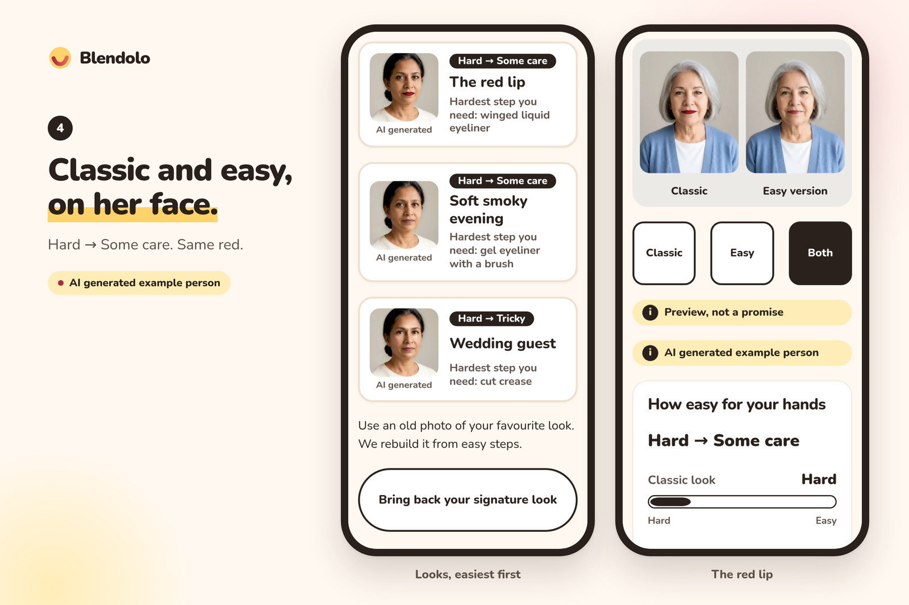
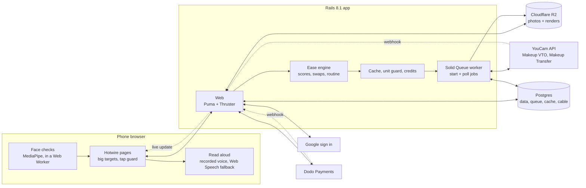
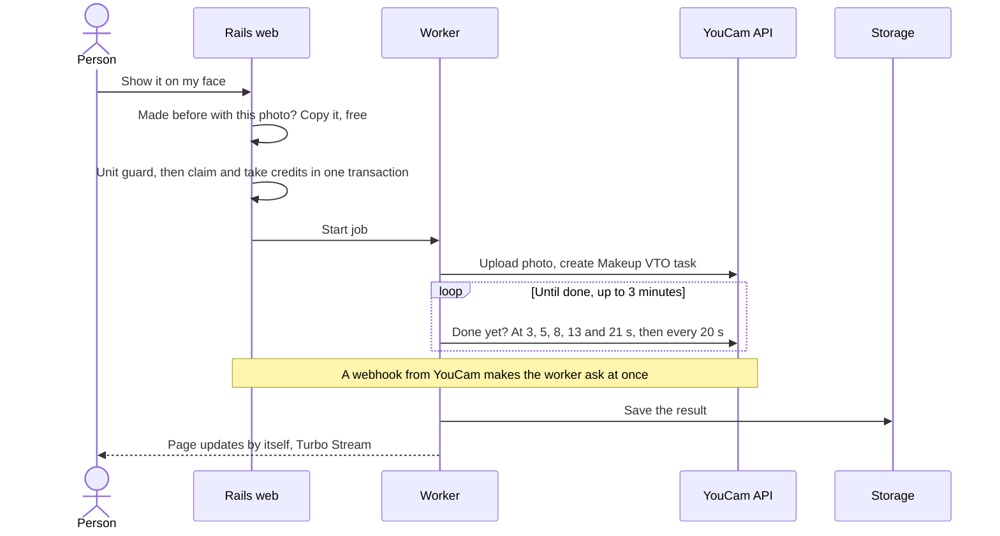

# Blendolo

**Makeup made easy for hands that shake.**

Makeup try-on for people with Parkinson's, essential tremor, arthritis, MS or after a stroke. Blendolo scores every look for *your* hands, swaps the hard steps for easier ones, and shows the classic and the easy version on your own face with the YouCam API.

**[Live site](https://blendolo.dijmo.com)** · **[Try an example person](https://blendolo.dijmo.com/examples)** (no photo, no sign in) · **[Demo video](https://youtu.be/cd1cSQ5E0Ys)** · **[For shops](https://blendolo.dijmo.com/brands)**

[](https://codespaces.new/inventionsbyhamid/blendolo)



## Inspiration

- Makeup tutorials assume a steady hand.
- More than 1 in 4 of 2,864 people with essential tremor say tremor affects putting on makeup, and 64% say it embarrasses them ([Gupta et al. 2021](https://pmc.ncbi.nlm.nih.gov/articles/PMC8710410)).
- 5.33 million women live with Parkinson's ([GBD 2021](https://www.frontiersin.org/journals/aging-neuroscience/articles/10.3389/fnagi.2024.1498756/full)). 194 million people have osteoarthritis in their hands, women about twice as often as men ([Wei et al. 2025](https://www.ncbi.nlm.nih.gov/pmc/articles/PMC12350485/)).
- "If I try to line my lips I wind up with a misshapen mouth" ([a blogger with parkinsonism](https://easilybridget.blogspot.com/2022/08/beauty-able-makeup-tips-for-people-with.html)).
- Today's help is scattered: tip sheets from charities, and single tools for single steps, like a $150 to $200 stabilised lipstick holder that only does lipstick.
- Virtual try-on shows a look on your face. It never asks whether your hands can do it. Blendolo does: **can I do this look, and what is the easy version of it on me?**

## What it does

- **5 questions about your hands** set your hand profile and how big the buttons get.
- **Hands-free photo**: prop the phone up. It waits for one face, eyes open and a still second, and talks you through it.
- **8 looks, scored for your hands**: Easy, Some care, Tricky or Hard, by the look's hardest step, shown as "Hard → Some care".
- **Classic vs easy, on your face**: hard steps become easier ones, rendered side by side. Winged liquid liner → shadow liner. Liquid matte lipstick → tinted balm dabbed on with a finger.
- **Signature look**: an old photo of a look you loved, put on today's face, then rebuilt from easy steps.
- **Step cards read aloud**, a **shopping list** tagged by grip and closure, and a **share link** for a helper or an occupational therapist.
- **Ease tags API for shops**: `GET /api/ease_tags?product_format=stick&closure=pull_cap&grip=chunky`. Free, no key.
- **Accounts and plans**: Google sign in, 2 free credits, a Look Pack ($7.99, 16 credits) and a Clinic plan for occupational therapists ($19 a month, 40 credits), through Dodo Payments.
- **3 example people** (Rosa, June, Amara) with stored results: explore everything with no photo and no account.
- **Follows its own advice**: 64 to 104 px targets, a tap counts on release, repeat taps are ignored, no drag, swipe, pinch or long press.

## Tech stack

| Layer | What |
|---|---|
| App | Ruby 3.4, Rails 8.1, Hotwire (Turbo + Stimulus), Tailwind CSS 4, importmap |
| Data and jobs | PostgreSQL 18, Solid Queue, Solid Cache, Solid Cable (no Redis) |
| Files | Active Storage on Cloudflare R2, WebP variants with libvips |
| In the browser | MediaPipe Face Landmarker in a Web Worker, recorded voice lines with Web Speech as a fallback, a service worker |
| Services | YouCam Makeup VTO and Makeup Transfer, Google sign in (OmniAuth), Dodo Payments (Standard Webhooks) |
| Quality | Minitest, Capybara with headless Chrome, axe-core, RuboCop, Brakeman |
| Hosting | One Docker image (Thruster + Puma, or the worker), on Coolify |

## Architecture



**One preview, step by step**



## YouCam API

| Endpoint | Used for | Units |
|---|---|---|
| `POST /s2s/v2.0/task/makeup-vto` | Classic and easy look on your photo, the easy signature look, Softer and Bolder | 1 per render, any number of effects |
| `POST /s2s/v2.0/task/mu-transfer` | Signature look from an old photo | 2 |
| `POST /s2s/v2.0/file`, task status, credit endpoints | Upload, polling, live prices and balance for the unit guard | 0 |

- **Every swap is a parameter change** in one Makeup VTO call ([mapping](docs/effects-vocabulary.md)).
- **Never pays twice**: one render per photo and effect list, under a row lock. A repeat view or a double tap is free.
- **Never runs dry**: a daily unit cap, a balance floor, and example people that never call the API.
- **Stays under the rate limit**: 1.4 s between calls across web and worker.
- **Never hangs**: webhook plus polling, with a clear message after 3 minutes.

## Run it locally

No keys needed. You need Ruby 3.4.12, PostgreSQL and libvips.

```sh
git clone https://github.com/inventionsbyhamid/blendolo.git
cd blendolo
bin/setup   # gems, database, 3 example people, then starts the app
```

- Open http://localhost:3107. Run `bin/dev` to start it again later.
- **Or one click**: open it in GitHub Codespaces (badge above), or "Reopen in Container" in VS Code, then run `bin/dev`.
- Locally, each paid service has a stand-in:

| In production | Locally, with no key |
|---|---|
| YouCam API | A fake provider with sample images. No units spent. |
| Google sign in | "Sign in as a test person (local only)". |
| Dodo Payments | A local test checkout that adds credits through the same code as a real payment. |

- To use the real services, set the keys in [.env.example](.env.example) (`APPEARANCE_PROVIDER=youcam`, `YOUCAM_API_KEYS`, `GOOGLE_CLIENT_ID`, `DODO_API_KEY` and so on).

## Tests

```sh
bin/rails test          # unit and integration
bin/rails test:system   # browser tests, headless Chrome
bin/ci                  # everything: RuboCop, Brakeman, audits, tests, seeds
```

- 498 unit and integration tests and 65 system tests, all green at the last CI run.
- System tests measure every button and link on five key screens at phone width, and run axe accessibility checks.
- `BLENDOLO_CI_HOST=<ssh host> bin/ci-remote <lane>` runs the same CI in Docker on another machine.

## Code map

| Path | What |
|---|---|
| `config/blendolo/*.yml` | 40 steps, 8 looks, example people, products, plans, credits. Data, not code |
| `app/models/ease/` | Ease engine: hand profiles, step and look scores, swaps, routine order |
| `app/models/appearance/` | Provider interface, YouCam adapter, fake provider |
| `app/models/billing/` | Billing interface, Dodo adapter, plans, margin check |
| `app/models/credits.rb`, `unit_guard.rb`, `previews.rb` | Credits ledger, unit caps, render cache |
| `app/javascript/capture/`, `workers/` | Face checks and colour sampling in the browser |

## Deploy

- One Docker image: the web app, or the Solid Queue worker with `BLENDOLO_PROCESS=jobs`.
- It refuses to boot while a required setting is missing. [.env.example](.env.example) explains each one.
- Health check `GET /up`. Full guide: [docs/deploy.md](docs/deploy.md).

## Challenges

- **No layers.** Makeup VTO returns one image, so we can't switch a single step off. We render the whole look twice, classic and easy, and compare render with render.
- **Transfer returns only a picture.** To rebuild a signature look we read its colours in the browser. Old prints fade reds towards brick, so colours snap to our shades with CIE94.
- **Units move before results do.** They're taken when a task starts and refunded after an engine error. The unit guard counts calls in flight and treats unclear failures as charged.
- **Tremor and buttons.** A double tap must never cost twice, so every request is idempotent and repeat taps are blocked.
- **A smooth camera on any phone.** Face checks first ran on the main thread and the preview lagged. In a Web Worker, the main thread went from 94% busy to about 3%.
- **Mascara.** We found no honest easy swap, so the app says so instead of inventing one.

## What's next

- **Test with more people with tremor, arthritis, MS and stroke, and with occupational therapists.** This comes first.
- **Read the face once** with YouCam Face Attributes: no wing for hooded lids, powder instead of gel for sparse brows.
- **A glow where each step goes** on the step cards.
- **An ease tags feed** for a retailer or an adaptive brand, with Arthritis Foundation certified products as a filter.
- **Less skin smoothing** in previews, so older skin looks like itself.

## Honest limits

- Ease scores are our own rubric from published guidance and people's own words. Not a clinical measure. One person with Parkinson's has tried it so far; no wider testing yet.
- Previews are clean; real lines wobble. That's why the easy steps are forgiving ones.
- Makeup Transfer moves a whole look at once. Colours read from old photos are approximate.
- Example people are AI generated. The shop catalogue is made-up demo products.
- Not a medical device. No medical advice.

## Privacy

- No trackers, no passwords. Example people and starting a kit need no account.
- Photos go to our storage, and to YouCam only to make previews. YouCam deletes its copies within 30 days.
- Kits are deleted 30 days after your last visit, or at once with "Delete everything".
- Dodo Payments handles cards. We never see them.

## License

[AGPL-3.0](LICENSE)
